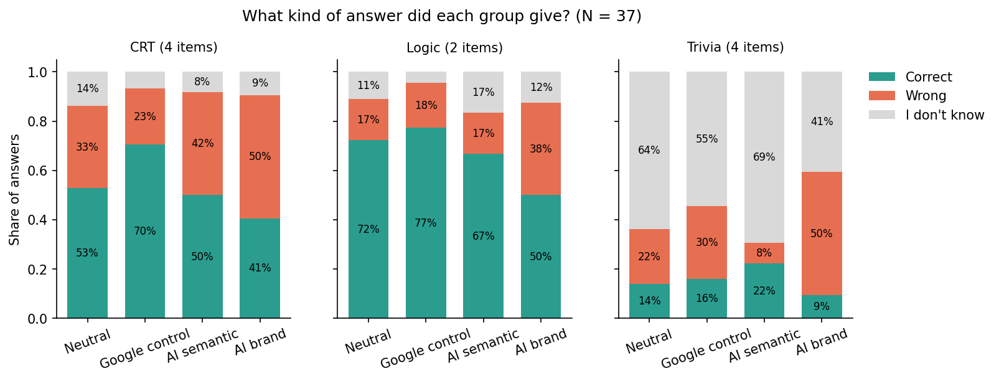
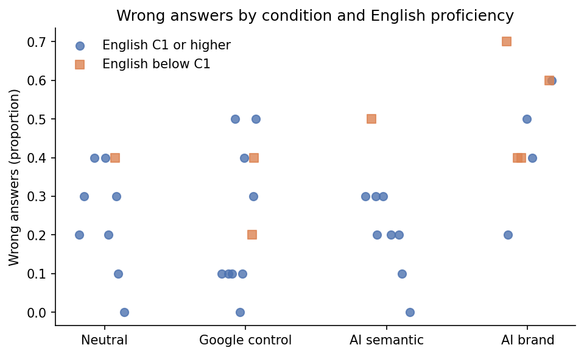

# Does being reminded of AI make people think less?

An exploratory analysis of a small priming experiment, done in Python (pandas, SciPy, statsmodels).

I am a fourth-year psychology student and I am currently teaching myself data analysis in Python. This repository is one of the first things I have done with it: I took an experiment I helped design and run, and redid the analysis with code to see if they hold up.

**Short version:** the group that saw AI logos gave about twice as many wrong answers as the other groups. That sounds like a finding. After checking it properly I do not think I can call it one, and the notebooks show why.



## The experiment

The Google Effect is the tendency to remember less when you know the information is one search away (Sparrow et al., 2011). These days we delegate whole tasks to AI not just facts. So I wondered whether simply being reminded of AI makes people put in less cognitive effort. To be fair, I have always been a bit skeptical about priming studies, and many of them do not replicate. But it was a fun idea to test.

We built the experiment in Resultal, a tool for mobile experiments, as a group practicum in the Brand, Design and Psychology course at Hanze University of Applied Sciences (autumn 2026). 39 people took part, recruited through snowball sampling.

Participants were randomly assigned to one of four conditions. Each started with a short "which one do you prefer" task, and the prime was hidden in the last two pairs:

| Condition | n | Prime |
|---|---|---|
| Neutral | 9 | everyday brand logos, no technology |
| Google control | 12 | search engine logos |
| AI brand | 9 | AI company logos |
| AI semantic | 9 | the phrases "Artificial Intelligence" and "Machine Learning", disguised as a font preference question |

Then everyone answered the same ten questions, each with an "I don't know" option:

- four Cognitive Reflection Test items (CRT-2; Thomson & Oppenheimer, 2016), where an intuitive but wrong answer has to be suppressed;
- two logic questions that are solvable but need attention;
- four trivia questions that were hard on purpose, to see how long people wait before giving up.

If an "AI Effect" exists, the AI groups should guess more, give up faster, or both.

## What I found

1. **The AI brand group gave more wrong answers**: 48% against 23 to 26% in the other groups, *F*(3, 33) = 4.46, *p* = .010. Most of this comes from the trivia questions, where they guessed instead of choosing "I don't know". Their guesses were not better than anyone else's.
2. **But that group also had the weakest English.** Half of the participants who rated their English below C1 happened to land in the AI brand group, and lower proficiency goes with more wrong answers in every group. With English proficiency in the model, the effect of condition is no longer significant (*p* = .063). With eight or nine people per group I cannot pull the two explanations apart.
3. **The other AI group showed nothing.** Participants primed with the words instead of the logos looked just like the neutral group. So there is no consistent "AI Effect" across the two AI primes.
4. **The give-up time effect from my course paper does not hold up.** It is only significant when times are averaged with means, and it comes from a few very slow participants in one group.
5. **The study could not have detected a realistic effect anyway.** With this sample size only very large effects (eta squared of about .25 or more) had a good chance of showing up.



So the result is inconclusive, and I am fine with that. What I got out of it is a much better idea of how easy it is to find something "significant" in a small dataset, and of what to check before believing it.

## From course paper to code

The numbers in my original course paper were produced by asking an AI assistant to analyse the data. No statistical software, no code. Redoing it in Python changed the picture:

| | Course paper | This analysis |
|---|---|---|
| Group means | Table 1 | reproduced, they were correct |
| Wrong answers | significant, read as an effect of the AI brand prime | significant, but confounded with English proficiency |
| Give-up time | significant, "the AI brand group gave up fastest" | depends on a few slow participants in the AI semantic group; AI brand and Neutral do not differ |
| Data quality | "we have not checked the data for outliers" | two participants tapped through the cover task (where the prime was shown) in a fraction of a second and are excluded from the main analysis |
| Effect sizes, assumption checks, correction for multiple tests | not reported | reported |
| Robustness | not reported | key tests repeated under three versions of the sample |

There was also a step in between: a first pair of notebooks, which I then reviewed and reworked. The notebooks say where and why they differ from that first version. The main lessons from that round:

- I had removed one slow participant by typing in their ID after looking at a boxplot. Four other participants had an equally slow trial and stayed in. Now nobody is removed for being slow, and I use median response times.
- I identified the demographic rows with a hand-made dictionary of answers, which silently dropped everyone who answered "Prefer not to say". The export already had a column for this.
- pandas read the answer option "None" as a missing value, and I did not notice.
- I ran two-way ANOVAs with interactions on cells that contained one or two people.
- My interpretation lived in code comments, and the notebook did not run from top to bottom.

## Repository

```
├── notebooks/
│   ├── 01_data_cleaning.ipynb          from the export to one row per participant
│   └── 02_statistical_analysis.ipynb   descriptives, ANOVAs, robustness checks
├── data/
│   ├── trials_anonymized.csv           one row per response (input of notebook 01)
│   ├── participants_clean.csv          one row per participant (output of notebook 01)
│   └── README.md                       what every column means
├── figures/                            figures saved by the notebooks
├── scripts/
│   └── anonymize_raw_export.py         how the shared data file was made
└── requirements.txt
```

GitHub shows the notebooks with all output, so you can read them without running anything. Start with `01_data_cleaning.ipynb`.

## Running it yourself

```bash
git clone https://github.com/helloiambora/ai-effect-priming.git
cd ai-effect-priming
pip install -r requirements.txt
jupyter notebook
```

Run notebook 01 first, then notebook 02. They run on Python 3.8 with pandas 2.0 and on Python 3.13 with pandas 2.2.

## Data and privacy

The experiment was run as a course practicum, supervised by the course lecturer. [It did not go through a formal ethics committee review.]

Participants were 18 or older, read a study information and informed consent page before starting, and took part voluntarily. They could stop at any time by closing the browser.

Like most priming studies, this one used a cover story. Participants were told the study was about design preferences and question difficulty, not about being reminded of AI. They were told the real purpose afterwards.

The data contains no names, e-mail addresses or IP addresses. Before sharing it I removed the submission timestamps and the platform's internal IDs, and replaced the participant IDs with shuffled codes (scripts/anonymize_raw_export.py). The raw export is not in this repository.

## How this was made, and where AI was used

I want to be clear about this, because the whole project is about what happens when we hand our thinking to AI.

- The research question, the experiment and the data collection are human work: mine and my group's.
- The analysis in the course paper was done by an AI assistant in a chat. This repository exists because I wanted to check it.
- The notebooks were "vibe coded". I described what I wanted, an AI assistant wrote most of the pandas and statsmodels code, and I ran it, read it and fixed things when they broke. I then asked an AI assistant to review that first version critically, and reworked the notebooks based on that review. Several of the problems listed above were found in that review and not by me.
- What I did myself: deciding what to check, making the analysis decisions and being able to defend them, and going through the code until I understood what each step does.

I am still learning Python. I could not have written all of this from a blank page yet, and I would rather say that than pretend otherwise.

## References

Sparrow, B., Liu, J., & Wegner, D. M. (2011). Google effects on memory: Cognitive consequences of having information at our fingertips. *Science, 333*(6043), 776–778. https://doi.org/10.1126/science.1207745

Thomson, K. S., & Oppenheimer, D. M. (2016). Investigating an alternate form of the Cognitive Reflection Test. *Judgment and Decision Making, 11*(1), 99–113. https://doi.org/10.1017/S1930297500007622

---

Bora Şenoğlu, November 2026
